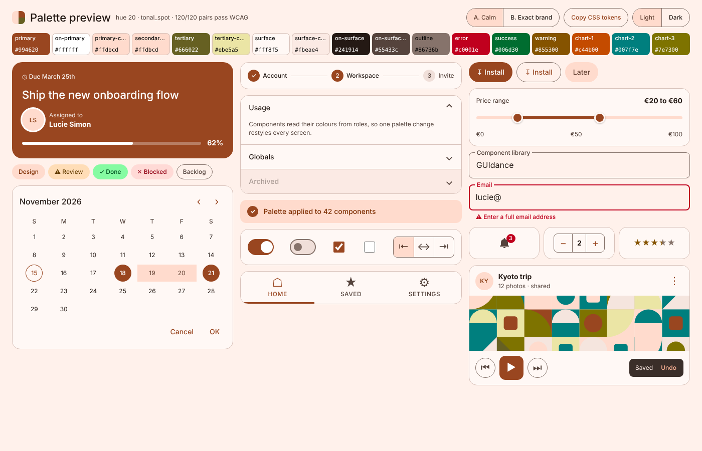
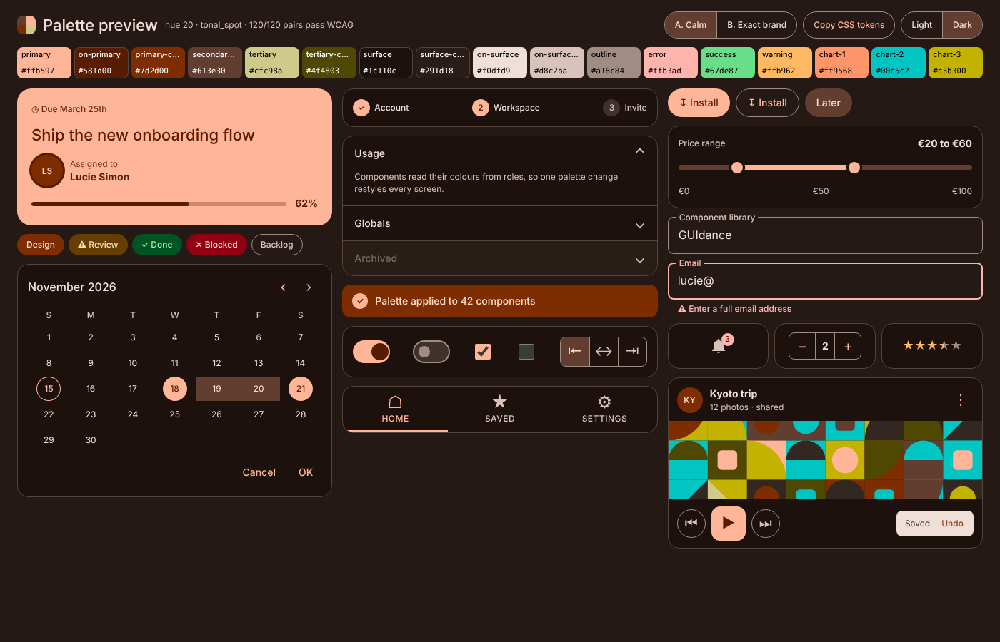

# GUIdance

**GUI + guidance.** A Claude skill that makes interfaces look professionally designed: spacing, corners, type, colour, motion and accessibility, built on the published rules of Apple, Google Material, the W3C and large-scale UX research. Every rule says where it comes from and when it is fine to break it.



<details><summary>Same palette in dark</summary>



</details>

## What it does

- **Sets up a design system in your project.** Works with any stack (plain CSS, Tailwind, MUI, shadcn/ui, Bootstrap, Sass, even native theme code): it finds where your styling lives, reads the tokens you already have, flags spacing, radius, type and motion values that sit off the Material 3 scales, and writes clean tokens (spacing, radius, elevation, type, motion, colours) in your stack's own format.
- **Picks your colours with you.** Learns what your product is (and asks if it can't tell), proposes two palettes built from your brand colour, and shows them on a one-screen showcase of real components in light and dark before anything is written. Every palette is checked against WCAG contrast: 120 colour pairs, light and dark.
- **Builds UI that follows the rules.** When Claude creates or changes an interface, it uses your tokens and the rules as minimums, then checks its own work.
- **Inspects your pages on every screen size.** Opens a page from your local dev server at mobile, tablet and desktop widths, and on both sides of each of your own breakpoints, where layouts tend to break. It lists every inconsistency it measures:
  - off-scale spacing and uneven gaps;
  - mismatched corners, borders and shadows;
  - mixed icon sizes and styles;
  - near-duplicate colours and components that drifted apart;
  - content that overflows or gets cut off;
  - keyboard problems: missing focus rings, focus hidden under sticky bars, clickable things the keyboard can't reach.

  One ordered list, most serious first, each with why it's a problem and how to fix it.
- **Fixes what it found.** Shows the planned changes, applies them at the source (a token, the shared component, the parent's spacing), then measures again to confirm each fix.
- **Audits what you have.** Measures instead of guessing: contrast ratios, touch target sizes, font sizes, line lengths. Reports each finding with its severity, the rule, the source and the fix.

Claude does all the work itself, with no Python, Node or network needed. The exact maths (contrast-checked palettes, Material values, token formats) ships with the skill as data, so it never needs to search the web or run code.

## Install

The skill itself needs no Python, no Node and no packages.

### Requirements

Some features need a **browser Claude can drive**, which is a separate tool, not part of this skill: a browser MCP server such as [Playwright MCP](https://github.com/microsoft/playwright-mcp) or [Chrome DevTools MCP](https://github.com/ChromeDevTools/chrome-devtools-mcp), Claude in Chrome, or the built-in browser of the Claude desktop app.

| Feature | Without a browser |
| --- | --- |
| `/guidance inspect` (measures pages at mobile, tablet, desktop and breakpoint widths, plus keyboard focus) | **Required.** Claude hands you the snippets to paste into your browser's DevTools console, one per width, and works from the results you send back. |
| `/guidance check` (targets, typography, contrast numbers) | **Required.** Same DevTools fallback. |
| `/guidance fix` (measuring again after the changes) | Optional. Claude makes the fixes, then asks you to re-run the snippets or checks the code by reading it. |
| `/guidance audit` (the measured part) | Optional. Claude reviews the code only and labels findings "read from code, not measured". |
| `/guidance setup` (showing the colour preview) | Optional. The preview shows as an artifact in Claude apps, or Claude gives you the file to open yourself. |
| `/guidance build` (checking its own work in the page) | Optional. The check is done by reading the code instead. |

Everything else (rules, tokens, palettes, writing files) works with no extra tools.

**Claude Code**

```bash
git clone https://github.com/Sladeck/GUIdance.git
cp -r GUIdance/skills/guidance ~/.claude/skills/guidance     # all your projects
# or: cp -r GUIdance/skills/guidance .claude/skills/guidance  (one project)
```

**Claude apps (web, desktop)**

Zip the `skills/guidance` folder and upload it as a custom skill in Claude's settings.

**About page checks.** `inspect` and `check` are meant for your local dev pages during a coding session. A public URL works too, through a real browser only: fetched HTML is never enough, since many sites build the page with JavaScript. Even then the result is a snapshot, as cookie banners, lazy loading and the signed-out view can differ from what users see.

## How to use it

Start in a project with `/guidance setup`. Claude looks at the project, asks a few questions if it needs to, shows you two colour palettes on a component preview, and writes the tokens once you pick one. After that, just work: ask Claude to build a screen and it follows the rules, or run `/guidance inspect /settings` to see what's off on mobile, tablet and desktop, then `/guidance fix` to clean it up.

Plain requests work too: "set up design tokens", "check this page for inconsistencies", "build a settings screen".

**See it on a real page:** [`examples/sprout`](examples/sprout) is a small hand-written dashboard before and after GUIdance, with the palette preview, the full inspect report (17 findings across phone, tablet, desktop and breakpoint widths) and the clean re-check.

## Commands

| Command | What it does |
| --- | --- |
| `/guidance` | Lists the commands. |
| `/guidance setup` | Learns what the project is, proposes two colour palettes with a light and dark preview, then writes or fixes design tokens (spacing, radius, type, motion, colours) in your stack's format. Never overwrites a file, and shows every change before making it. |
| `/guidance build <what>` | Builds or changes UI with your tokens and the rules, then checks the result. |
| `/guidance audit [target]` | Full review of a file, folder, component or page, or of your uncommitted changes when no target is given. Findings are ranked Hard / Strong / Default, each with rule, source and fix. Changes nothing until you ask. |
| `/guidance inspect [page]` | Opens a page (a route like `/settings`, a page or component file, or a description) at mobile, tablet, desktop and breakpoint widths, and returns one ordered list of inconsistencies: spacing, gaps, borders, corners, shadows, icons, colours, type, overflow, keyboard and focus. Each finding says where it is in your code, why it's a problem and how to fix it. Starts your dev server if it isn't running. |
| `/guidance fix [which]` | Fixes the findings of the last inspect, audit or check: all of them, by number (`1-5`) or by severity (`hard`). Shows the plan first, applies it, then measures again and reports what is fixed, what is left and anything new. |
| `/guidance check [page]` | Quick numbers-only pass on a page: touch targets, typography and contrast, as a short table and a one-line verdict. |

## Why I made this

I was sick of searching again and again for the same answers: how much white space between sections, which corner radius, how big body text should be, which colours actually work together, how long an animation should last. The answers exist, spread across Apple's guidelines, Material Design, the W3C and years of usability research, but every project started with the same hunt, and the results still didn't look pro-made.

So I gathered the best of it in one place, ranked by how much evidence stands behind each source, settled the cases where they disagree, and turned it into something Claude can apply directly: real tokens in real code, palettes you can see before you commit, and checks that measure instead of guess.

## How sources are weighted

| Tier | Sources | Why |
| --- | --- | --- |
| **S** | W3C WCAG 2.2 | International standard, referenced by law. Wins every conflict it covers. |
| **A** | Apple Human Interface Guidelines, Google Material Design 3 | Define what users already expect on their platforms. |
| **A** | Baymard Institute, GOV.UK Design System | Large-scale published research (Baymard: 200,000+ research hours, 4,400+ test sessions). |
| **B** | Nielsen Norman Group | Decades of mostly small qualitative studies: strong on what goes wrong, weaker on exact numbers. |
| **C** | Secondary summaries | Used for a formula or a clear statement, never decisive. |

Rules without a source are labelled `judgment`. Where sources disagree, the higher tier wins; at the same tier, context decides (Apple on Apple platforms, Material on Android, Baymard for shops and long forms, GOV.UK for public services and one-question-per-page forms).

## What's inside

| Path | What it is |
| --- | --- |
| `skills/guidance/SKILL.md` | The skill: commands and how Claude runs them |
| `skills/guidance/references/rules.md` | 44 rules with source, severity and when to break them |
| `skills/guidance/references/design-data.md` | Every verified number, plus the brand-colour procedures |
| `skills/guidance/references/palettes/` | 4 palette styles x 73 hues, light and dark, every row WCAG-checked |
| `skills/guidance/references/formats/` | Worked token files (CSS, Tailwind v4 and v3, MUI, Sass) that Claude models any stack on |
| `skills/guidance/references/browser-checks.md` | Snippets that measure a rendered page: targets, typography, contrast, consistency and layout, keyboard and focus |
| `skills/guidance/assets/preview.html` | The colour preview: computes and checks palettes in the browser |
| `examples/sprout/` | A sample page before and after setup and inspect, with the reports |
| `tools/` | Maintainer scripts that regenerate the palette tables and templates. Not needed to use the skill |

## Citations and resources

Verified on 2026-11-02 (rules), 2026-11-14 (colour, type scale, stack formats) and 2026-11-15 (elevation, icons, breakpoints, focus, shadcn/ui and Bootstrap). Every value taken from these sources is stored in [`skills/guidance/references/design-data.md`](skills/guidance/references/design-data.md).

**Standards (W3C)**
- [Understanding SC 1.4.3 Contrast (Minimum)](https://www.w3.org/WAI/WCAG22/Understanding/contrast-minimum.html)
- [Understanding SC 1.4.11 Non-text Contrast](https://www.w3.org/WAI/WCAG22/Understanding/non-text-contrast.html)
- [Understanding SC 1.4.10 Reflow](https://www.w3.org/WAI/WCAG22/Understanding/reflow.html)
- [Understanding SC 2.4.7 Focus Visible](https://www.w3.org/WAI/WCAG22/Understanding/focus-visible.html)
- [Understanding SC 2.4.11 Focus Not Obscured (Minimum)](https://www.w3.org/WAI/WCAG22/Understanding/focus-not-obscured-minimum.html)
- [Understanding SC 2.5.8 Target Size (Minimum)](https://www.w3.org/WAI/WCAG22/Understanding/target-size-minimum.html)
- [What's New in WCAG 2.2](https://www.w3.org/WAI/standards-guidelines/wcag/new-in-22)
- [Technique C39: prefers-reduced-motion](https://www.w3.org/WAI/WCAG22/Techniques/css/C39.html)

**Apple**
- [Human Interface Guidelines: Accessibility](https://developer.apple.com/design/human-interface-guidelines/accessibility)
- [Human Interface Guidelines: Typography](https://developer.apple.com/design/human-interface-guidelines/typography)
- [Human Interface Guidelines: Alerts](https://developer.apple.com/design/human-interface-guidelines/alerts)

**Google**
- [Material Design 3: Spacing](https://m3.material.io/styles/spacing/tokens)
- [Material Design 3: Corner radius scale](https://m3.material.io/styles/shape/corner-radius-scale)
- [Material Design 3: Type scale and tokens](https://m3.material.io/styles/typography/type-scale-tokens)
- [Material Design 3: Color roles](https://m3.material.io/styles/color/roles)
- [Material Design 3: Easing and duration](https://m3.material.io/styles/motion/easing-and-duration/tokens-specs)
- [material-color-utilities](https://github.com/material-foundation/material-color-utilities) (role tones and scheme variants)
- [Material Web: Elevation](https://material-web.dev/components/elevation) (levels and shadow values)
- [Material Symbols guide](https://developers.google.com/fonts/docs/material_symbols) (icon sizes, weight, grade)
- [Android Developers: Window size classes](https://developer.android.com/develop/ui/compose/layouts/adaptive/use-window-size-classes) (breakpoints)
- [Android Accessibility Help: Touch target size](https://support.google.com/accessibility/android/answer/7101858)

**Research**
- Baymard Institute: [Avoid multi-column forms](https://baymard.com/research-articles/avoid-multi-column-forms), [Inline form validation](https://baymard.com/research-articles/inline-form-validation), [Line length readability](https://baymard.com/research-articles/line-length-readability), [Research methodology](https://baymard.com/research/methodology)
- GOV.UK Design System: [Recover from validation errors](https://design-system.service.gov.uk/patterns/validation)
- Nielsen Norman Group: [Response times: the 3 important limits](https://www.nngroup.com/articles/response-times-3-important-limits/), [Skeleton screens 101](https://www.nngroup.com/articles/skeleton-screens/), [Error-message guidelines](https://www.nngroup.com/articles/error-message-guidelines/), [Proximity principle](https://www.nngroup.com/articles/gestalt-proximity/), [Visual hierarchy](https://www.nngroup.com/articles/visual-hierarchy-ux-definition/), [Confirmation dialogs](https://www.nngroup.com/articles/confirmation-dialog/), [Placeholders in form fields are harmful](https://www.nngroup.com/videos/placeholders-form-fields/), [5 test users: qual vs quant](https://www.nngroup.com/articles/5-test-users-qual-quant/)

**Secondary**
- [Laws of UX: Law of Proximity](https://lawsofux.com/law-of-proximity/)
- [30 seconds of code: Nested border radius](https://30secondsofcode.org/css/s/nested-border-radius)

**Framework documentation** (for writing tokens, not design evidence)
- Tailwind CSS v4: [Theme variables](https://tailwindcss.com/docs/theme), [Dark mode](https://tailwindcss.com/docs/dark-mode)
- MUI: [Dark mode](https://mui.com/material-ui/customization/dark-mode/), [CSS theme variables](https://mui.com/material-ui/customization/css-theme-variables/configuration/)
- shadcn/ui: [Theming](https://ui.shadcn.com/docs/theming)
- Bootstrap 5.3: [Sass](https://getbootstrap.com/docs/5.3/customize/sass/), [Color modes](https://getbootstrap.com/docs/5.3/customize/color-modes/)

GUIdance is not affiliated with or endorsed by Apple, Google, the W3C, Baymard Institute, GOV.UK or Nielsen Norman Group. It cites their public guidance and stores the numeric values it uses, not their text.

## License

[MIT](LICENSE). Use it, change it, ship it.
