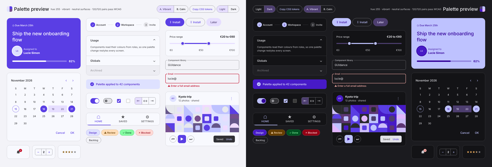

# GUIdance

GUIdance is a Claude skill that gives your interfaces a professional finish: consistent spacing, corners, type, colour, motion and accessibility. It is a set of design rules taken from Apple, Google Material, the W3C and large-scale UX research, ranked by how much evidence stands behind each one, plus the tools to use them: it sets up design tokens and colour palettes in your project, makes Claude follow the rules when it builds UI, and checks your pages against them at every screen size. Every rule says where it comes from and when it is fine to break it.

> [!IMPORTANT]
> **GUIdance is not a UI kit, a template or a component library.** It ships no components and no ready-made pages. Your components, your framework and your design stay yours; GUIdance makes them consistent.

## Summary

- [What it does](#what-it-does)
- [What it adds to your project](#what-it-adds-to-your-project)
- [Install](#install)
- [How to use it](#how-to-use-it)
- [Commands](#commands)
- [How sources are weighted](#how-sources-are-weighted)
- [Citations and resources](#citations-and-resources)
- [Why I made this](#why-i-made-this)
- [License](#license)

## What it does

- **Sets up a design system in your project.** Works with any stack (plain CSS, Tailwind, MUI, shadcn/ui, Bootstrap, Sass, even native theme code): it finds where your styling lives, reads the tokens you already have, flags spacing, radius, type and motion values that sit off the Material 3 scales, and writes clean tokens (spacing, radius, elevation, type, motion, colours) in your stack's own format.
- **Picks your colours with you.** Learns what your product is (and asks if it can't tell), proposes two palettes built from your brand colour, with near-neutral backgrounds the way GitHub, IBM and Radix do it (or a two-tone brand with one bright accent, like many admin dashboards), and shows them on sample components in light and dark before anything is written. Every palette is checked against WCAG contrast: 120 colour pairs, light and dark.
- **Sets your density.** Three spacing presets (compact, default, comfortable) map the same spacing roles to different steps of the scale, and each role can be tuned on top, so a data tool and a marketing site do not end up with the same rhythm. Ask with no argument and Claude proposes two directions built for your product, as it does for colours. Ask in plain words ("more room between the cards", "tighter lists on the reports page") and it finds the right value to move. It works on the whole app or a single page; font sizes and touch targets never shrink.
- **Builds UI that follows the rules.** When Claude creates or changes an interface, it uses your tokens and the rules as minimums, then checks its own work.
- **Reviews your code and your pages on every screen size.** Checks the code against the rules, then opens the page from your local dev server at mobile, tablet and desktop widths, and on both sides of each of your own breakpoints, where layouts tend to break. It measures instead of guessing:
  - off-scale spacing and uneven gaps;
  - mismatched corners, borders and shadows;
  - mixed icon sizes and styles;
  - near-duplicate colours and components that drifted apart;
  - content that overflows or gets cut off;
  - contrast ratios, touch target sizes, font sizes and line lengths;
  - keyboard problems: missing focus rings, focus hidden under sticky bars, clickable things the keyboard can't reach.

  One ordered list, most serious first, each with where it is in your code, why it's a problem (rule and source) and how to fix it.
- **Fixes what it found.** Shows the planned changes, applies them at the source (a token, the shared component, the parent's spacing), then measures again to confirm each fix.

Claude does all the work itself. The exact maths (contrast-checked palettes, Material values, token formats) ships with the skill as data.

## What it adds to your project

Design tokens: named values your whole UI uses instead of numbers picked by eye. Claude writes them in your stack's own format (CSS variables, a Tailwind theme, an MUI theme, Sass variables...) and uses them from then on.

| Tokens | What you get | Based on |
| --- | --- | --- |
| **Colours** | A full colour scheme from your brand colour: 37 colour roles in light and dark (see below), plus 5 chart colours. Every pair checked for contrast | Material 3 roles, WCAG 2.2 |
| **Spacing** | 18 steps on an 8px grid: 0, 2, 4, 6, 8, 10, 12, 14, 16, 20, 24, 32 ... 72px | Material 3 |
| **Density** | Spacing roles (field, card, group, section, page gutter, control height...) in three presets: compact, default, comfortable | Material 3 density, SAP Fiori, AWS Cloudscape; preset values are judgment |
| **Corner radius** | 0, 4, 8, 12, 16, 20, 28, 32, 48px and full (pills) | Material 3 |
| **Elevation** | 6 shadow levels, from flat to dragged | Material 3 |
| **Type** | Headline 32, title 22, body 16, small body 14, label 12px, with line heights and weights | Material 3, Apple |
| **Motion** | Durations from 50 to 600ms, 5 easing curves, shorter versions for reduced motion | Material 3, WCAG |
| **Targets and focus** | 24px minimum and 44px touch target sizes, focus ring width and offset, readable line length | WCAG 2.2, Apple |

**Colour roles.** A colour role is a colour named after its job, not its look: your code says `--color-primary` or `--color-on-surface` instead of `#5a3ee4`. Change the palette and every button, background and text colour follows, in light and dark.

| Group | Roles | Count |
| --- | --- | --- |
| **Brand colours:** primary, secondary, tertiary | Each comes as four: the colour (a filled button), *on*-colour (the text on it), a soft *container* version (a tinted card or chip) and *on-container* (the text on that) | 12 |
| **Status:** error, success, warning | The same four each | 12 |
| **Backgrounds** | `surface` plus 5 container levels, from the page to raised panels | 6 |
| **Text on backgrounds** | `on-surface` (main text), `on-surface-variant` (secondary text) | 2 |
| **Lines** | `outline` (field borders, 3:1 contrast), `outline-variant` (dividers) | 2 |
| **Inverse** | Dark-on-light flips for things like snackbars | 3 |

A few of the tokens it writes:

```css
--space-200: 16px;      --radius-md: 12px;     --text-body: 1rem;
--space-300: 24px;      --radius-lg: 16px;     --duration-short-4: 200ms;
--color-primary: #5a3ee4;           --color-on-primary: #ffffff;
--elevation-1: 0 1px 2px 0 rgb(0 0 0 / 0.3), 0 1px 3px 1px rgb(0 0 0 / 0.15);
```

## Install

### Claude Code (plugin)

In a Claude Code session:

```
/plugin install guidance --marketplace Sladeck/GUIdance
```

On versions before 2.1.275, add the marketplace first:

```
/plugin marketplace add Sladeck/GUIdance
/plugin install guidance@guidance
```

Installed as a plugin, the command is `/guidance:guidance` (type `/guidance` and pick it), so `/guidance setup` becomes `/guidance:guidance setup`. Asking in plain words ("set up design tokens", "review the settings page") works either way. Update with `/plugin marketplace update guidance`.

### Claude Code (manual copy)

Gives the short `/guidance` command.

```bash
git clone https://github.com/Sladeck/GUIdance.git
cp -r GUIdance/skills/guidance ~/.claude/skills/guidance     # all your projects
# or: cp -r GUIdance/skills/guidance .claude/skills/guidance  (one project)
```

### Claude apps (web, desktop)

Zip the `skills/guidance` folder and upload it as a custom skill in Claude's settings.

### Requirements

Some features need a **browser Claude can drive**, which is a separate tool, not part of this skill: a browser MCP server such as [Playwright MCP](https://github.com/microsoft/playwright-mcp) or [Chrome DevTools MCP](https://github.com/ChromeDevTools/chrome-devtools-mcp), Claude in Chrome, or the built-in browser of the Claude desktop app.

| Feature | Without a browser |
| --- | --- |
| `/guidance review` (measuring pages at every width, plus keyboard focus) | Optional. Claude hands you the snippets to paste into your browser's DevTools console, one per width, and works from the results you send back. Or it reviews the code only and labels findings "read from code, not measured". |
| `/guidance review quick` (targets, typography, contrast numbers) | **Required.** Without one, Claude hands you the same DevTools snippets. |
| `/guidance fix` (measuring again after the changes) | Optional. Claude makes the fixes, then asks you to re-run the snippets or checks the code by reading it. |
| `/guidance setup` (showing the colour preview) | Optional. The preview shows as an artifact in Claude apps, or Claude gives you the file to open yourself. |
| `/guidance spacing` (previewing the two directions, measuring and screenshots after the change) | Optional. The directions are shown as tables of values, and the result is checked by reading the token file. |
| `/guidance build` (checking its own work in the page) | Optional. The check is done by reading the code instead. |

**About page checks.** `review` is meant for your local dev pages during a coding session. A public URL works too, through a real browser only: fetched HTML is never enough, since many sites build the page with JavaScript. Even then the result is a snapshot, as cookie banners, lazy loading and the signed-out view can differ from what users see.

## How to use it

Start in a project with `/guidance setup`. Claude looks at the project, asks a few questions if it needs to, shows you two colour palettes on a component preview, and writes the tokens once you pick one.

This is the preview you choose from, with sample components only, to judge the colours (light on the left, dark mirrored on the right):



<sub>Full-size: [light](docs/preview-light.png), [dark](docs/preview-dark.png).</sub>

After that, just work: ask Claude to build a screen and it follows the rules, or run `/guidance review /settings` to see what's off on mobile, tablet and desktop, then `/guidance fix` to clean it up.

Plain requests work too: "set up design tokens", "make it denser", "review this page", "does this look right on mobile?", "build a settings screen".

**See it on a real page:** [`examples/sprout`](examples/sprout) is a small hand-written dashboard before and after GUIdance, with the palette preview, the full review report (17 findings across phone, tablet, desktop and breakpoint widths) and the clean re-check.

## Commands

| Command | What it does |
| --- | --- |
| `/guidance` | Lists the commands. |
| `/guidance setup` | Learns what the project is, proposes two colour palettes with a light and dark preview, then writes or fixes design tokens (spacing, radius, type, motion, colours) in your stack's format. Never overwrites a file, and shows every change before making it. |
| `/guidance spacing [preset or what to change] [page\|all]` | Sets or changes density. A preset: `/guidance spacing compact` changes the whole project, `/guidance spacing compact /reports` one page. Plain words: `/guidance spacing more room between the cards`, `/guidance spacing tighter lists on /reports`. Nothing: it proposes two directions built for your product, with the plain preset as a third choice. Shows every value before and after, changes the spacing role tokens at their source, then measures the page. |
| `/guidance build <what>` | Builds or changes UI with your tokens and the rules, then checks the result. |
| `/guidance review [target]` | Finds what's wrong. Give it a page (a route like `/settings`, a page file or a description), a file, folder or component, or nothing for your uncommitted changes. It reviews the code against the rules and measures the page at mobile, tablet, desktop and breakpoint widths: spacing, gaps, borders, corners, shadows, icons, colours, contrast, targets, type, overflow, keyboard and focus. One ordered list, Hard / Strong / Default, each with where it is in your code, why and how to fix it. Starts your dev server if it isn't running. Changes nothing until you ask. |
| `/guidance review quick [page]` | Numbers only: touch targets, typography and contrast, as a short table and a one-line verdict. |
| `/guidance fix [which]` | Fixes the findings of the last review: all of them, by number (`1-5`) or by severity (`hard`). Shows the plan first, applies it, then measures again and reports what is fixed, what is left and anything new. |

## How sources are weighted

| Tier | Sources | Why |
| --- | --- | --- |
| **S** | W3C WCAG 2.2 | International standard, referenced by law. Wins every conflict it covers. |
| **A** | Apple Human Interface Guidelines, Google Material Design 3 | Define what users already expect on their platforms. |
| **A** | Baymard Institute, GOV.UK Design System | Large-scale published research (Baymard: 200,000+ research hours, 4,400+ test sessions). |
| **A** | Peer-reviewed studies with 400+ people or field data | Measured at scale (up to 120 million taps and 2.4 million ratings). One study each, so evidence rather than a standard. |
| **B** | Nielsen Norman Group | Decades of mostly small qualitative studies: strong on what goes wrong, weaker on exact numbers. |
| **B** | Smaller peer-reviewed experiments | Controlled and measured; good on the direction of an effect, weaker on exact thresholds. |
| **C** | Secondary summaries | Used for a formula or a clear statement, never decisive. |

Rules without a source are labelled `judgment`. Where sources disagree, the higher tier wins; at the same tier, context decides (Apple on Apple platforms, Material on Android, Baymard for shops and long forms, GOV.UK for public services and one-question-per-page forms).

## Citations and resources

Verified on 2026-11-02 (rules), 2026-11-14 (colour, type scale, stack formats) and 2026-11-15 (elevation, icons, breakpoints, focus, shadcn/ui and Bootstrap, density). Peer-reviewed studies were added on 2026-11-15 from their published abstracts; full texts were not read. Every value taken from these sources is stored in [`skills/guidance/references/data/`](skills/guidance/references/data/).

**Standards (W3C)**
- [Understanding SC 1.4.3 Contrast (Minimum)](https://www.w3.org/WAI/WCAG22/Understanding/contrast-minimum.html)
- [Understanding SC 1.4.11 Non-text Contrast](https://www.w3.org/WAI/WCAG22/Understanding/non-text-contrast.html)
- [Understanding SC 1.4.10 Reflow](https://www.w3.org/WAI/WCAG22/Understanding/reflow.html)
- [Understanding SC 2.4.7 Focus Visible](https://www.w3.org/WAI/WCAG22/Understanding/focus-visible.html)
- [Understanding SC 2.4.11 Focus Not Obscured (Minimum)](https://www.w3.org/WAI/WCAG22/Understanding/focus-not-obscured-minimum.html)
- [Understanding SC 2.5.8 Target Size (Minimum)](https://www.w3.org/WAI/WCAG22/Understanding/target-size-minimum.html)
- [What's New in WCAG 2.2](https://www.w3.org/WAI/standards-guidelines/wcag/new-in-22)
- [Technique C39: prefers-reduced-motion](https://www.w3.org/WAI/WCAG22/Techniques/css/C39.html)

**Apple**
- [Human Interface Guidelines: Accessibility](https://developer.apple.com/design/human-interface-guidelines/accessibility)
- [Human Interface Guidelines: Typography](https://developer.apple.com/design/human-interface-guidelines/typography)
- [Human Interface Guidelines: Alerts](https://developer.apple.com/design/human-interface-guidelines/alerts)

**Google**
- [Material Design 3: Spacing](https://m3.material.io/styles/spacing/tokens)
- [Material Design 3: Density](https://m3.material.io/foundations/layout/grids-spacing/density)
- [Material Design 3: Corner radius scale](https://m3.material.io/styles/shape/corner-radius-scale)
- [Material Design 3: Type scale and tokens](https://m3.material.io/styles/typography/type-scale-tokens)
- [Material Design 3: Color roles](https://m3.material.io/styles/color/roles)
- [Material Design 3: Easing and duration](https://m3.material.io/styles/motion/easing-and-duration/tokens-specs)
- [material-color-utilities](https://github.com/material-foundation/material-color-utilities) (role tones and scheme variants)
- [Material Web: Elevation](https://material-web.dev/components/elevation) (levels and shadow values)
- [Material Symbols guide](https://developers.google.com/fonts/docs/material_symbols) (icon sizes, weight, grade)
- [Android Developers: Window size classes](https://developer.android.com/develop/ui/compose/layouts/adaptive/use-window-size-classes) (breakpoints)
- [Android Accessibility Help: Touch target size](https://support.google.com/accessibility/android/answer/7101858)

**Research**
- Baymard Institute: [Avoid multi-column forms](https://baymard.com/research-articles/avoid-multi-column-forms), [Inline form validation](https://baymard.com/research-articles/inline-form-validation), [Line length readability](https://baymard.com/research-articles/line-length-readability), [Research methodology](https://baymard.com/research/methodology)
- GOV.UK Design System: [Recover from validation errors](https://design-system.service.gov.uk/patterns/validation)
- Nielsen Norman Group: [Response times: the 3 important limits](https://www.nngroup.com/articles/response-times-3-important-limits/), [Skeleton screens 101](https://www.nngroup.com/articles/skeleton-screens/), [Error-message guidelines](https://www.nngroup.com/articles/error-message-guidelines/), [Proximity principle](https://www.nngroup.com/articles/gestalt-proximity/), [Visual hierarchy](https://www.nngroup.com/articles/visual-hierarchy-ux-definition/), [Confirmation dialogs](https://www.nngroup.com/articles/confirmation-dialog/), [Placeholders in form fields are harmful](https://www.nngroup.com/videos/placeholders-form-fields/), [5 test users: qual vs quant](https://www.nngroup.com/articles/5-test-users-qual-quant/)

**Peer-reviewed studies** (numbers taken from the published abstracts)
- Touch: Henze et al., [100,000,000 taps](https://consensus.app/papers/details/w:c498eb74-279c-4fa9-9f5b-c9d150dc3919/) (MobileHCI 2011); Parhi et al., [Target size study for one-handed thumb use](https://consensus.app/papers/details/w:e2bdf7b7-a7b1-41d5-8409-eddaaf21d30c/) (MobileHCI 2006); Yamanaka et al., [Behavioral differences between tap and swipe](https://consensus.app/papers/details/w:42218538-5a60-4b13-800d-0784735f4a7c/) (CHI 2024)
- First impressions: Reinecke et al., [Predicting users' first impressions of website aesthetics](https://consensus.app/papers/details/w:c542c130-f681-4f51-9f51-f8df9b6a7aa5/) (CHI 2013) and [Quantifying visual preferences around the world](https://consensus.app/papers/details/w:fa53f007-d546-44a3-a225-49a2974d1cb4/) (CHI 2014); Tuch et al., [Visual complexity and prototypicality](https://consensus.app/papers/details/w:64c01ca4-5200-48e1-966f-12b6054e7f73/) (IJHCS 2012); Seckler et al., [Objective design factors and subjective aesthetics](https://consensus.app/papers/details/w:91daa016-41f7-432f-b423-91a0f8988484/) (CHB 2015)
- Reading: Rello et al., [Make it big!](https://consensus.app/papers/details/w:c450318c-b710-404a-9091-77c2f5e420bb/) (CHI 2016) and [Readable text for people with dyslexia](https://consensus.app/papers/details/w:5970367e-3bb3-422a-8c85-2db03bf8bcca/) (UAIS 2015); Wallace et al., [Towards individuated reading experiences](https://consensus.app/papers/details/w:97e9d83b-53ef-496e-bdea-0113a38ef93d/) (TOCHI 2022) and [Space for readability](https://consensus.app/papers/details/w:ebeab8aa-4155-4967-ac1d-45115be5d985/) (Journal of Vision 2022)
- Light and dark: Palmén et al., [How bold can we be?](https://consensus.app/papers/details/w:0615a93d-471e-4418-a5e8-e3dfbbcecb8d/) (CHI 2023); Buchner et al., [Polarity irrespective of illumination](https://consensus.app/papers/details/w:091b9f63-90f9-435c-a880-9e5779cc7d7b/) (Ergonomics 2007) and [Polarity advantage due to luminance](https://consensus.app/papers/details/w:b62a5d16-6b5f-4a1c-a7af-34f1a1df8089/) (Ergonomics 2009); Piepenbrock et al., [Small character sizes](https://consensus.app/papers/details/w:48fdf521-5105-4b9e-b1e1-790f73678555/) (Human Factors 2013) and [Younger and older adults](https://consensus.app/papers/details/w:882ab7e7-e2e7-403a-b1ec-ba387e2da412/) (Ergonomics 2013); While et al., [Dark mode or light mode for visualization](https://consensus.app/papers/details/w:41493219-ef46-4a27-8e49-9181e17fdb1f/) (IEEE VIS 2024)
- Waiting: Tan et al., [Counting the wait](https://consensus.app/papers/details/w:c81e24ee-626a-43f3-b726-17bcf9449605/) (CHI 2026); Wang et al., [Loading animation and perceived waiting time](https://consensus.app/papers/details/w:bbd4a9b0-5b33-41fd-a11b-c40655b2701f/) (JTAER 2025)
- Forms and guidelines: Bargas-Avila et al., [Do not show errors right away](https://consensus.app/papers/details/w:74ac86cf-5c9b-4ff7-8707-bcab95c7495e/) (Interacting with Computers 2007); Seckler et al., [Designing usable web forms](https://consensus.app/papers/details/w:b97b4351-73fd-4f9f-86e4-db37676cbfd5/) (CHI 2014); Falkowska et al., [Eye-tracking metrics to evaluate user experiences](https://consensus.app/papers/details/w:3c2584ba-6ae1-4e50-8c47-353d69f79cf5/) (Sensors 2025)

**Design systems** (how large products use colour)
- [GitHub Primer: Color primitives](https://primer.style/foundations/primitives/color)
- [IBM Carbon: Color overview](https://carbondesignsystem.com/elements/color/overview/)
- [Radix Colors: Composing a palette](https://www.radix-ui.com/colors/docs/palette-composition/composing-a-palette)
- [SAP Fiori: Content density (cozy and compact)](https://www.sap.com/design-system/fiori-design-web/v1-154/foundations/visual/cozy-compact) and [AWS Cloudscape: Content density](https://cloudscape.design/foundation/visual-foundation/content-density/) (how products offer density)

**Secondary**
- [Laws of UX: Law of Proximity](https://lawsofux.com/law-of-proximity/)
- [30 seconds of code: Nested border radius](https://30secondsofcode.org/css/s/nested-border-radius)

**Framework documentation** (for writing tokens, not design evidence)
- Tailwind CSS v4: [Theme variables](https://tailwindcss.com/docs/theme), [Dark mode](https://tailwindcss.com/docs/dark-mode)
- MUI: [Dark mode](https://mui.com/material-ui/customization/dark-mode/), [CSS theme variables](https://mui.com/material-ui/customization/css-theme-variables/configuration/)
- shadcn/ui: [Theming](https://ui.shadcn.com/docs/theming)
- Bootstrap 5.3: [Sass](https://getbootstrap.com/docs/5.3/customize/sass/), [Color modes](https://getbootstrap.com/docs/5.3/customize/color-modes/)

GUIdance is not affiliated with or endorsed by Apple, Google, the W3C, Baymard Institute, GOV.UK or Nielsen Norman Group. It cites their public guidance and stores the numeric values it uses, not their text.

## Why I made this

I was sick of searching again and again for the same answers: how much white space between sections, which corner radius, how big body text should be, which colours actually work together, how long an animation should last. The answers exist, spread across Apple's guidelines, Material Design, the W3C and years of usability research, but every project started with the same hunt, and the results still didn't look pro-made.

So I gathered the best of it in one place, ranked by how much evidence stands behind each source, settled the cases where they disagree, and turned it into something Claude can apply directly: real tokens in real code, palettes you can see before you commit, and checks that measure instead of guess.

## License

[MIT](LICENSE). Use it, change it, ship it.
