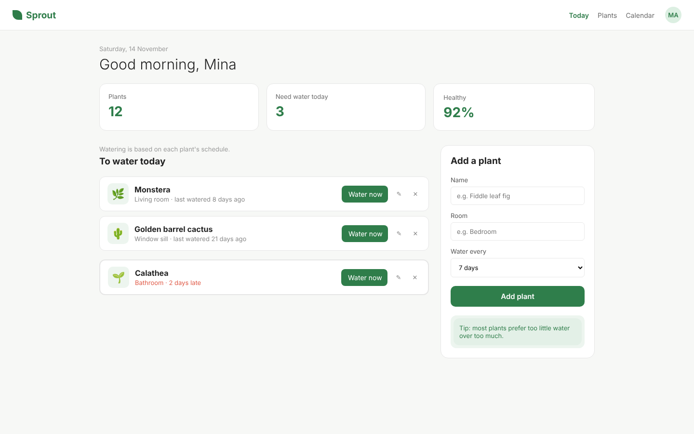
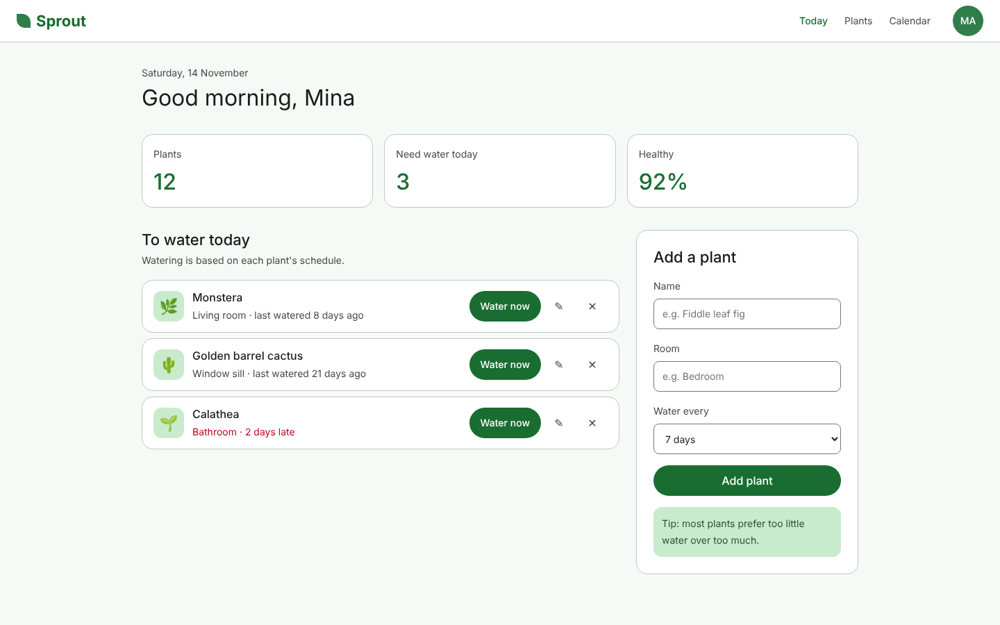
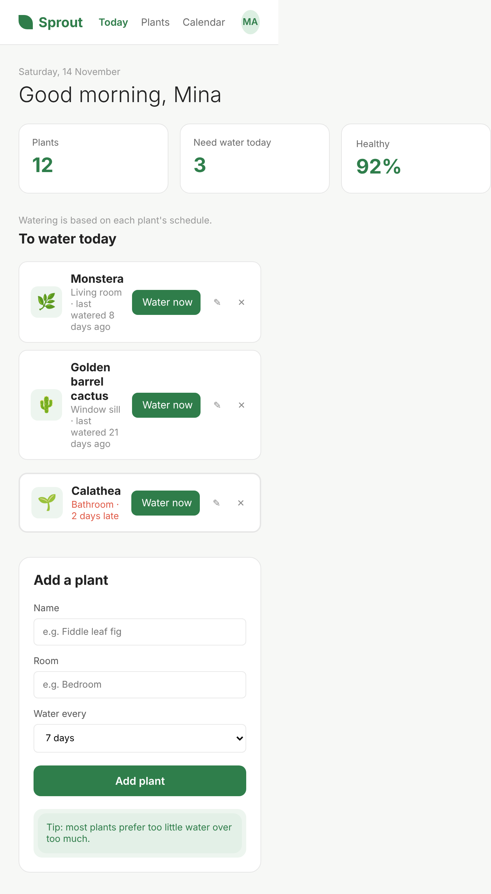
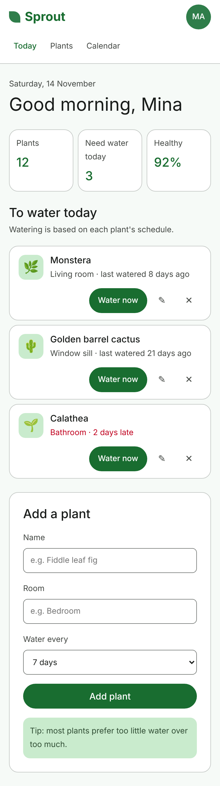
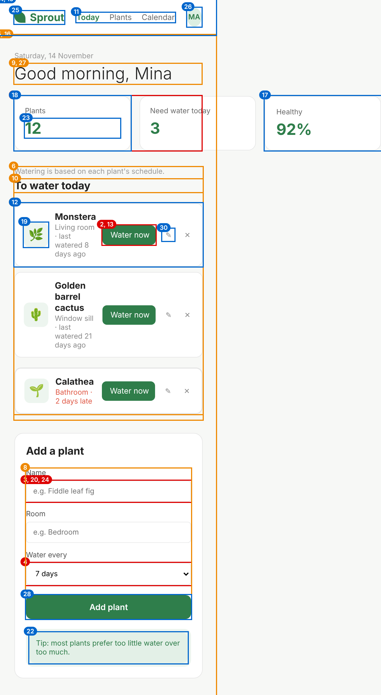
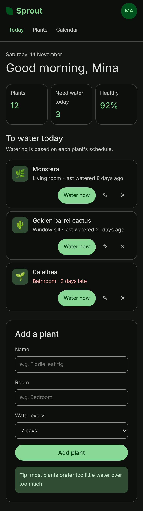

# Example: Sprout

Sprout is a small, made-up plant-care dashboard, written by hand the way many real pages are: values picked by eye, colours copied around, and checked only on a laptop. This folder shows what GUIdance does to it.

Open `before/index.html` and `after/index.html` in a browser to compare. No server or install is needed. Resize the window to phone width to see the difference that matters most.

| | Before | After |
| --- | --- | --- |
| Desktop |  |  |
| Mobile (390px) |  |  |

## What was run

1. **`/guidance setup`** ([log](guidance-run/setup.md)):
   - detected plain CSS and found the brand green `#2f7d4a`;
   - located it in the palette tables by hand (row h140);
   - showed two palettes in the [preview](guidance-run/palette-preview.html), both with near-grey backgrounds so the green stays on actions;
   - wrote [`after/guidance.css`](after/guidance.css) from the chosen one.
2. **`/guidance inspect`** on the before page at 390, 768, 1440 and 320px wide, on both sides of its breakpoint (800/801), and through the keyboard. The report is [inspect-before.md](guidance-run/inspect-before.md): 17 findings, most serious first, each with where, why and how to fix it. The overlay below numbers each measured problem on the page.
3. **The fixes** (what `/guidance fix` applies): [`after/styles.css`](after/styles.css) rebuilt on the tokens, plus small structural changes in [`after/index.html`](after/index.html) (heading groups, no inline styles, no nested tip box).
4. **`/guidance inspect`** again on the after page: [0 findings at every width and breakpoint, in light and dark, with every button showing keyboard focus](guidance-run/inspect-after.md).

| What inspect saw on the before page at 390px | After, dark theme |
| --- | --- |
|  |  |

## The numbers

| | Before | After |
| --- | --- | --- |
| Page wider than a 390px phone | 688px | fits |
| Text under 4.5:1 contrast | 7 | 0 |
| Form field edges | 1.21:1 | 3:1 or more |
| Distinct spacing values off the scale | 6 | 0 |
| Corner radii | 6 different, 3 off the scale | 3 steps and pills |
| Font weights | 4, including a light 300 heading | 3 |
| Tap targets under 44px on mobile | 14 | 0 |
| Buttons with no visible keyboard focus | 10 | 0 |
| Icon sizes | 13px, too small | 16px glyphs in 44px buttons |
| Dark theme | none | automatic, every pair checked |

Everything in `guidance-run/` came from the skill's own files: the palette row, the CSS template and the browser snippets. The pages were served over http and the snippets ran in a headless browser (Playwright) standing in for Claude's browser tool. The skill itself needs no Python or Node.
