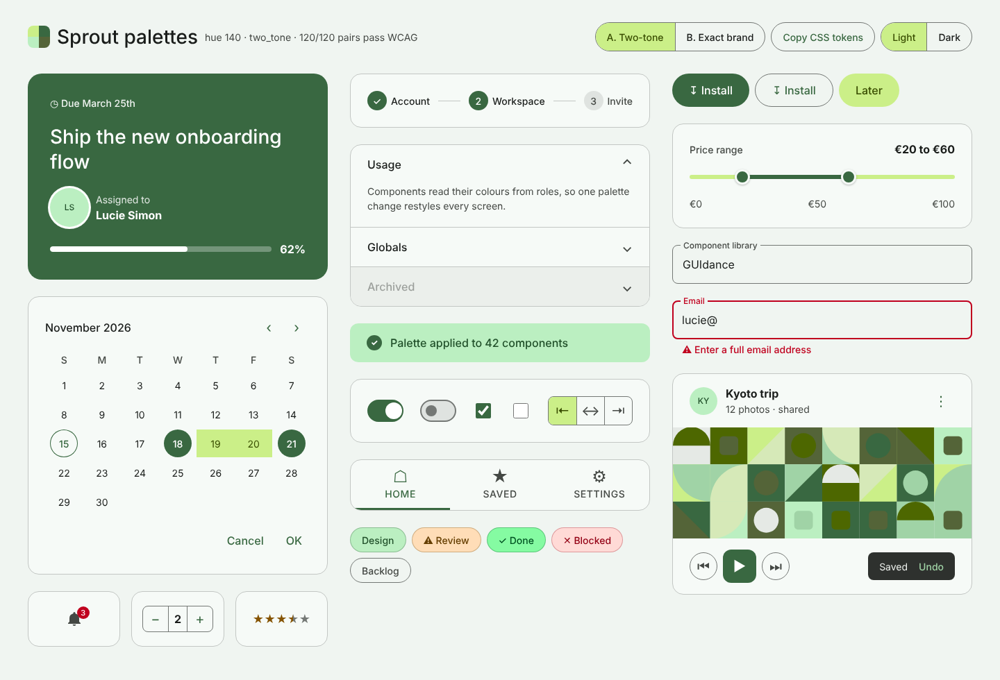
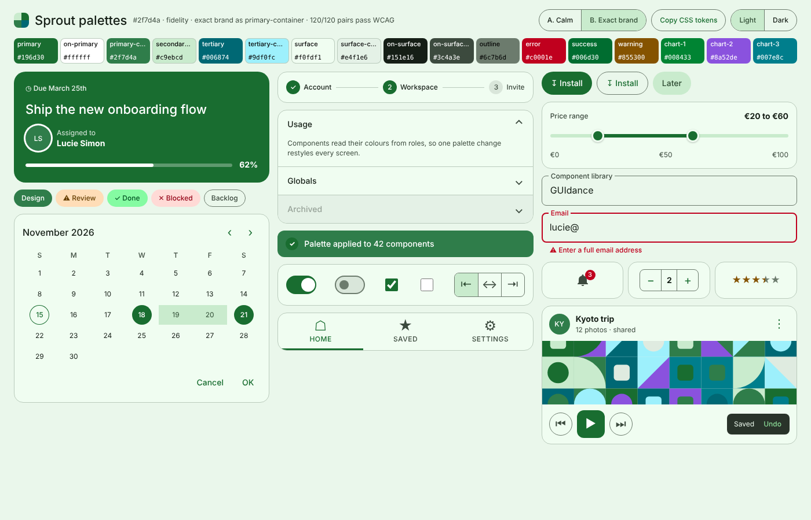

# `/guidance setup` on Sprout

What Claude did, step by step, following `skills/guidance/SKILL.md`.

## A. Understand the project

- **Stack:** no `package.json`, no framework, one `styles.css` linked from `index.html`. That makes it plain CSS, so the template is `references/formats/css.md`.
- **Existing tokens:** none. Every value is written by hand in `styles.css`.
- **Product:** a plant-care dashboard (page title "Sprout · Plant care"). The feel to aim for is calm.
- **Brand colour:** the logo green `#2f7d4a` (`.logo`, `.leaf`).

## B. Colour wizard

**Finding the palette row by hand** (`references/data/colour.md`):
- `#2f7d4a` → r 0.184, g 0.490, b 0.290. The max is g, d = 0.306, saturation 45% (not grey).
- Hue = 60 × ((0.290 − 0.184) / 0.306 + 2) = 140.8, which rounds to row **h140**.

**Exact-brand role:** the relative luminance is L ≈ 0.157.
- That is above 0.13, so the brand takes light `primary-container`.
- It is at or under 0.179, so the text on it is `#ffffff`. That is 5.06:1.

**Two directions:**
- **A. Two-tone:** `two_tone`, row 140: a deep green with a lime accent, the look of many admin dashboards.
- **B. Exact brand:** `fidelity`, with `#2f7d4a` kept as is.

Both use neutral surfaces (built into two-tone): near-grey backgrounds, text greys and outlines from row 140 of the `neutral` table, so the green goes on actions only, as in GitHub's or IBM's design systems.

**Preview:** `assets/preview.html` was copied to [`palette-preview.html`](palette-preview.html), and only its CONFIG block was edited:

```js
const CONFIG = {
  title: "Sprout palettes",
  palettes: [
    { name: "Two-tone", row: 140, variant: "two_tone" },
    { name: "Exact brand", row: 140, variant: "fidelity", brand: "#2f7d4a", surfaces: "neutral" }
  ]
};
```

Both palettes pass 120/120 WCAG pairs. The page also labels B "exact brand as primary-container", which matches the hand calculation.

| A. Two-tone | B. Exact brand |
| --- | --- |
|  |  |

**Pick:** B. Sprout already has a green worth keeping; two-tone would suit it too if it wanted a livelier dashboard look.

## C. Write the tokens

With no token system, Claude did the following:
1. Created `after/guidance.css` from the CSS template.
2. Filled every `{L.role}` and `{D.role}` from row `h140` of `palettes/tonal_spot.md`.
3. Replaced the two light roles the brand-colour procedure names (`primary-container` → `#2f7d4a`, `on-primary-container` → `#ffffff`), and took the 12 surface roles from row `h140` of `palettes/neutral.md`.
4. Recorded the palette in the file's header comment.
5. Added the wiring line `@import "./guidance.css";` at the top of `styles.css`.

Check: every colour in `guidance.css` matches the row exactly. Rendered contrast was 0 failures in light and dark.

The page was then rebuilt on the tokens (`after/styles.css`) to fix what `/guidance inspect` found: [inspect-before.md](inspect-before.md).
